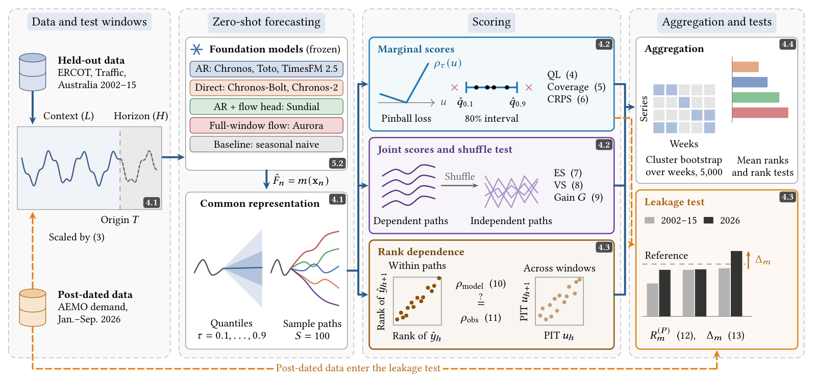

# CDL-Eval: A Zero-Shot Framework for Evaluating Calibration, Dependence, and Leakage of Time Series Foundation Models

[](LICENSE)
[](https://www.python.org/)
[](#citation)

> [!IMPORTANT]
> **Anonymized for double-anonymous peer review.** This repository accompanies a manuscript under review. Author
> names, affiliations, and links that could identify the authors have been removed, and the citation below is
> anonymous. Please do not attempt to identify the authors.

Code for the submission *CDL-Eval: A Zero-Shot Framework for Evaluating Calibration, Dependence, and Leakage of Time
Series Foundation Models*.

CDL-Eval scores the probabilistic forecasts of pretrained time series foundation models, applied without training or
fine-tuning, on accuracy (quantile loss and CRPS) and, separately, on three properties:

- **Calibration**: coverage of the central 80% interval, one-sided coverage and PIT histograms.
- **Dependence along sample paths**: a rank-based measure that compares the rank correlation of adjacent steps within
  the forecast paths (ρ<sub>model</sub>) with that of the observed PIT values (ρ<sub>obs</sub>), with the energy and
  variogram scores and the shuffle test.
- **Leakage**: the standing of each model relative to reference models on a public series and on data from the same
  source published after every model was released.

The repository holds the benchmark of seven foundation models (Chronos, Chronos-Bolt, Chronos-2, TimesFM 2.5, Toto,
Sundial and Aurora) and classical, trained and pretrained baselines on electricity demand in Texas and Australia and
road occupancy in San Francisco, at horizons of 24, 192 and 720 steps; the controlled simulation of the Supplementary
Material; the per-window results of every run; and the scripts that write every table and figure of the paper.



*Fig. 2 of the paper, one panel per step from left to right. Held-out and post-dated data are cut into test
windows. Each foundation model forecasts every window zero-shot, and quantile and sample-path outputs are brought to
one representation. Marginal scores, joint scores and the rank dependence measure are computed separately. Scores are
aggregated by a cluster bootstrap over calendar weeks and by rank tests, and the leakage test compares each model on
old and new data. Dark tags: sections of the paper; numbers in parentheses: equations.*

## Contents

| Folder or file | Content |
| --- | --- |
| [`realdata/`](realdata/) | Benchmark on real data: data loading and test windows, model runners, scores, added baselines, checks, report scripts, and the stored per-window results (`realdata/results/`) |
| [`simulation/`](simulation/) | Controlled simulation of autoregressive, diffusion, flow-matching and masked-diffusion forecasters (Section S3 of the Supplementary Material) and its results |
| [`scripts/`](scripts/) | `download_data.py` (datasets) and `reproduce.py` (every experiment of the paper, stage by stage, with the exact command lines) |
| [`requirements/`](requirements/) | Pinned dependencies of the four Python environments |
| `figstyle.py` | Shared style of the data figures |
| `outputs/` | Tables (`outputs/tables/*.tex`) and figures (`outputs/figures/*.pdf`) written by the report scripts |

## Requirements

Python 3.12 and, for the foundation models, an NVIDIA GPU with 16 GB of memory (the runs of the paper used one
GeForce RTX 5060 Ti with CUDA 12.8). Rebuilding the tables and figures from the stored results needs only a CPU.

The models need incompatible library versions, so the code runs in up to four environments:

| Environment | File | Used for |
| --- | --- | --- |
| main | [`requirements/main.txt`](requirements/main.txt) | Chronos, Chronos-Bolt, Chronos-2, TimesFM 2.5, Sundial, Aurora, seasonal naive, small forecasters, simulation, all report scripts |
| toto | [`requirements/toto.txt`](requirements/toto.txt) | Toto (`toto-ts` pins torch 2.7, transformers 4.52 and numpy 1.26) |
| baselines | [`requirements/baselines.txt`](requirements/baselines.txt) | Exponential smoothing, DeepAR, Lag-Llama, small forecasters with 512 context steps |
| sundial-generate | [`requirements/sundial-generate.txt`](requirements/sundial-generate.txt) | One check: Sundial through its released `generate()` routine (transformers 4.40.1) |

```bash
python -m venv .venv && source .venv/bin/activate            # Windows: .venv\Scripts\activate
pip install torch==2.11.0 torchvision==0.26.0 --index-url https://download.pytorch.org/whl/cu128
pip install -r requirements/main.txt
# aurora-model may replace the CUDA build of torch with a CPU build; reinstall it:
pip install --force-reinstall --no-deps torch==2.11.0 torchvision==0.26.0 --index-url https://download.pytorch.org/whl/cu128
```

The other environments are created in the same way from their files; each file lists its install commands. For only
rebuilding the tables and figures, `numpy`, `pandas`, `scipy` and `matplotlib` from `requirements/main.txt` suffice.

## Data

```bash
python scripts/download_data.py            # into realdata/data/ (about 130 MB); --dry-run lists the files
python realdata/fresh_data.py check         # definition check of the Monash series, validation of the ERCOT zones
```

| Dataset | Source | Role |
| --- | --- | --- |
| ERCOT load (8 weather zones, hourly) | `autogluon/chronos_datasets`, Hugging Face Hub | Benchmark, leakage test |
| Traffic occupancy (862 sensors, hourly) | `autogluon/chronos_datasets` | Benchmark |
| Australian electricity 2002–2015 (5 states, half-hourly) | `autogluon/chronos_datasets` | Benchmark, leakage test |
| AEMO 2026 (5 regions, Jan.–Sep. 2026) | AEMO price-and-demand files | Benchmark, leakage test |
| AEMO 2016–2019 | AEMO price-and-demand files | Leakage test |
| ERCOT 2026 (Jan.–Sep. 2026) | EIA-930 subregion files of the U.S. Energy Information Administration | Leakage test |

The EIA-930 file of the current half-year grows every month, and a later download adds months to the ERCOT 2026 data
and changes its test windows. The runs of the paper used the files of 28 October 2026, which end on 30 September 2026.

**Results archive.** The repository holds the per-window scores of every run (47 MB), which is all that the
report scripts need except two. `realdata/revision_report.py` and `realdata/extra_report.py` (Section S2 of the
Supplementary Material) read the full forecasts of every run: 531 files, 1.6 GB, plus the
trained DeepAR weights.
These files and a snapshot of the AEMO and EIA-930 data used in the paper are in a results archive whose link is
withheld for anonymity. Without the archive, `scripts/reproduce.py tables` skips these two scripts and says so.

## Pre-trained models

No foundation model is trained or fine-tuned. The weights are downloaded from the Hugging Face Hub on first use:

| Model | Checkpoint | Parameters | Generation |
| --- | --- | --- | --- |
| Chronos small, base | [`amazon/chronos-t5-small`](https://huggingface.co/amazon/chronos-t5-small), [`amazon/chronos-t5-base`](https://huggingface.co/amazon/chronos-t5-base) | 46M, 200M | Autoregressive over value tokens |
| Toto | [`Datadog/Toto-Open-Base-1.0`](https://huggingface.co/Datadog/Toto-Open-Base-1.0) | 151M | Autoregressive over patches; Student-t mixture per step |
| TimesFM 2.5 | [`google/timesfm-2.5-200m-pytorch`](https://huggingface.co/google/timesfm-2.5-200m-pytorch) | 200M | Autoregressive over patches; quantile head |
| Chronos-Bolt small, base | [`amazon/chronos-bolt-small`](https://huggingface.co/amazon/chronos-bolt-small), [`amazon/chronos-bolt-base`](https://huggingface.co/amazon/chronos-bolt-base) | 48M, 205M | Direct quantile head; median fed back beyond 64 steps |
| Chronos-2 | [`amazon/chronos-2`](https://huggingface.co/amazon/chronos-2) | 120M | Direct quantile head |
| Sundial | [`thuml/sundial-base-128m`](https://huggingface.co/thuml/sundial-base-128m) (model code revision `3212e42`) | 128M | Autoregressive backbone with a flow-matching head |
| Aurora | `aurora-model` 0.2.0 (`aurora.load_model()`) | 211M | Full-window flow matching over 48-step tokens |
| Lag-Llama (baseline) | [`time-series-foundation-models/Lag-Llama`](https://huggingface.co/time-series-foundation-models/Lag-Llama) | | Autoregressive, one step at a time |

Every model forecasts from 512 context steps (Lag-Llama from 32 and from 512).

Sundial is loaded with `trust_remote_code=True`; the benchmark calls its forward pass directly, because its generation
code expects an older transformers version (`realdata/sundial_official.py` checks the two against each other).

## Evaluation

Every experiment is a stage of [`scripts/reproduce.py`](scripts/reproduce.py), which holds the exact command lines of
the stored results. `--list` prints all jobs and `--dry-run` prints the commands of a stage without running them.

```bash
python scripts/reproduce.py --list
python scripts/reproduce.py benchmark --python-toto .venv-toto/bin/python   # foundation models, 24 to 720 steps
python scripts/reproduce.py first-round                                     # small forecasters, context checks
python scripts/reproduce.py windows                                         # calendar weeks for the bootstrap
python scripts/reproduce.py revision --python-toto .venv-toto/bin/python    # Section S2 experiments
python scripts/reproduce.py baselines --python-extra .venv-baselines/bin/python
python scripts/reproduce.py checks --python-sundial .venv-sundial/bin/python
python scripts/reproduce.py simulation
python scripts/reproduce.py tables                                          # all tables and figures (CPU)
```

The core command is `realdata/bench.py`, for example the 24-step benchmark on the three held-out datasets:

```bash
cd realdata
python bench.py --data heldout --horizon 24 --models naive bolt bolt_base chronos2 timesfm sundial aurora chronos --tag main
```

All models are scored on the same test windows: 300 per dataset at 24 steps and 150 at 192 and 720 steps, fixed by
random seeds. Sample-based models draw 100 paths per window with three sampling seeds at 24 steps (one for Chronos
base, and for Chronos small on AEMO 2026) and one seed at 192 and 720 steps. Each run appends
its scores to `realdata/results/bench_<tag>.json` and the per-window scores to `bench_<tag>_perwindow.npz`;
`--store rev2` also writes the full forecasts to `realdata/results/rev2/`. The GPU runs of the second-revision
stages (`revision` and `baselines`) took about 10 hours on the GPU above; `realdata/README.md` describes every script.

`python scripts/reproduce.py smoke` checks the pipeline on tiny settings in a few minutes (after the data download).

## Training

Only the baselines are trained; their training code runs as part of the stages above:

- **Small forecasters on real data** (`realdata/run.py`): the forecasters of `simulation/sim.py`, trained on the
  first 70% of each series with 48 context steps (16,384 windows, 3,000 steps of batch 256, three seeds); the paper
  reports the autoregressive forecaster with a Gaussian head and the full-window flow-matching forecaster.
  `realdata/bench_extra.py` trains these two with 512 context steps.
- **DeepAR** (`realdata/bench_extra.py`): GluonTS DeepAR with a Student-t output, trained per dataset (hyperparameters
  in the docstring of the script).
- **Simulation** (`simulation/sim.py`): six small forecasters (autoregressive, direct, autoregressive with a
  diffusion head, full-window diffusion, full-window flow matching, masked diffusion) on three synthetic datasets;
  `simulation/README.md` gives the configurations and commands.

Trained weights are written next to the results and are not part of the repository; a run retrains missing weights.

## Results

All tables and figures are rebuilt from the stored results, on a CPU, by

```bash
python scripts/reproduce.py tables          # writes outputs/tables/*.tex and outputs/figures/*.pdf
```

Average rank of the ten forecasters run on all four 24-step datasets (Table V of the paper; lower is better):

| Model | QL | CRPS | Cal. error | Mean |
| --- | ---: | ---: | ---: | ---: |
| Chronos-2 | 1.50 | 1.25 | 5.25 | 2.67 |
| TimesFM 2.5 | 2.75 | 3.00 | 3.25 | 3.00 |
| Chronos-Bolt base | 3.50 | 3.25 | 3.50 | 3.42 |
| Chronos-Bolt small | 5.00 | 5.00 | 4.00 | 4.67 |
| Toto | 6.50 | 6.50 | 1.50 | 4.83 |
| Chronos base | 4.75 | 4.25 | 7.25 | 5.42 |
| Sundial | 5.75 | 6.25 | 10.00 | 7.33 |
| Naive | 9.75 | 9.50 | 3.50 | 7.58 |
| Chronos small | 7.75 | 8.00 | 8.25 | 8.00 |
| Aurora | 7.75 | 8.00 | 8.50 | 8.08 |

QL: quantile loss at the levels 0.1 to 0.9; Cal. error: absolute difference between the coverage of the central 80%
interval and 80%. The ranks include model–dataset pairs with leakage; the paper also gives them without these pairs.

Every generated table and figure, with the script that writes it:

| Paper | Output | Script |
| --- | --- | --- |
| Table IV | `outputs/tables/real_table.tex` | [`realdata/bench_report.py`](realdata/bench_report.py) |
| Table V | `outputs/tables/rank_table.tex` | [`realdata/rank_stats.py`](realdata/rank_stats.py) |
| Table VI | `outputs/tables/rev2_extra.tex` | [`realdata/extra_report.py`](realdata/extra_report.py) |
| Table VII | `outputs/tables/rev2_onesided80.tex` | [`realdata/revision_report.py`](realdata/revision_report.py) |
| Table VIII | `outputs/tables/rev2_onesided_tails.tex` | [`realdata/revision_report.py`](realdata/revision_report.py) |
| Table IX | `outputs/tables/rev2_aggregates.tex` | [`realdata/revision_report.py`](realdata/revision_report.py) |
| Table X | `outputs/tables/rev2_context.tex` | [`realdata/revision_report.py`](realdata/revision_report.py) |
| Fig. 3 | `outputs/figures/accuracy.pdf` | [`realdata/bench_report.py`](realdata/bench_report.py) |
| Fig. 4 | `outputs/figures/dependence.pdf` | [`realdata/bench_report.py`](realdata/bench_report.py) |
| Fig. 5 | `outputs/figures/horizon.pdf` | [`realdata/bench_report.py`](realdata/bench_report.py) |
| Fig. 6 | `outputs/figures/rev2_leakage.pdf` | [`realdata/revision_report.py`](realdata/revision_report.py) |
| Fig. 7 | `outputs/figures/rev2_euler.pdf` | [`realdata/revision_report.py`](realdata/revision_report.py) |
| Table S2 | `outputs/tables/bench_all_table.tex` | [`realdata/bench_report.py`](realdata/bench_report.py) |
| Table S3 | `outputs/tables/real_robust_table.tex` | [`realdata/robust_report.py`](realdata/robust_report.py) |
| Table S4 | `outputs/tables/bench_long_table.tex` | [`realdata/bench_report.py`](realdata/bench_report.py) |
| Table S5 | `outputs/tables/bench_ci_table.tex` | [`realdata/bench_report.py`](realdata/bench_report.py) |
| Table S6 | `outputs/tables/bench_dep_table.tex` | [`realdata/bench_report.py`](realdata/bench_report.py) |
| Table S7 | `outputs/tables/shuffle_check_table.tex` | [`realdata/shuffle_check.py`](realdata/shuffle_check.py) |
| Table S8 | `outputs/tables/shuffle_dep_table.tex` | [`realdata/shuffle_check.py`](realdata/shuffle_check.py) |
| Table S9 | `outputs/tables/sundial_check_table.tex` | [`realdata/bench_report.py`](realdata/bench_report.py) |
| Table S10 | `outputs/tables/real_aurora_table.tex` | [`realdata/robust_report.py`](realdata/robust_report.py) |
| Table S11 | `outputs/tables/stats_table.tex` | [`realdata/rank_stats.py`](realdata/rank_stats.py) |
| Table S12 | `outputs/tables/wilcoxon_table.tex` | [`realdata/rank_stats.py`](realdata/rank_stats.py) |
| Table S13 | `outputs/tables/rank_clean_table.tex` | [`realdata/rank_stats.py`](realdata/rank_stats.py) |
| Table S14 | `outputs/tables/rev2_extra_long.tex` | [`realdata/extra_report.py`](realdata/extra_report.py) |
| Table S15 | `outputs/tables/rev2_leakage.tex` | [`realdata/revision_report.py`](realdata/revision_report.py) |
| Table S16 | `outputs/tables/gauss_sampler_table.tex` | [`realdata/sampler_gauss.py`](realdata/sampler_gauss.py) |
| Table S17 | `outputs/tables/rev2_euler.tex` | [`realdata/revision_report.py`](realdata/revision_report.py) |
| Table S18 | `outputs/tables/rev2_spread.tex` | [`realdata/revision_report.py`](realdata/revision_report.py) |
| Table S19 | `outputs/tables/rev2_copula.tex` | [`realdata/revision_report.py`](realdata/revision_report.py) |
| Table S20 | `outputs/tables/rev2_dependence.tex` | [`realdata/revision_report.py`](realdata/revision_report.py) |
| Table S21 | `outputs/tables/rev2_dependence_long.tex` | [`realdata/revision_report.py`](realdata/revision_report.py) |
| Table S22 | `outputs/tables/rev2_chunked.tex` | [`realdata/revision_report.py`](realdata/revision_report.py) |
| Table S23 | `outputs/tables/rev2_decision.tex` | [`realdata/revision_report.py`](realdata/revision_report.py) |
| Table S24 | `outputs/tables/sim_table.tex` | [`simulation/plots.py`](simulation/plots.py) |
| Fig. S1 | `outputs/figures/rev2_pit_hist.pdf` | [`realdata/revision_report.py`](realdata/revision_report.py) |
| Fig. S2 | `outputs/figures/sim_calibration.pdf` | [`simulation/plots.py`](simulation/plots.py) |
| Fig. S3 | `outputs/figures/sim_cost_data.pdf` | [`simulation/plots.py`](simulation/plots.py) |

Figs. 1 and 2 and Tables I, II, III, S1 and S25 of the paper are diagrams or tables written in the LaTeX source, not generated from results. Numbers
quoted in the text are printed by the report scripts and stored in `realdata/results/rev2/report.json`.

## Citation

<h2 align="center">Anonymous Authors.<br><i>CDL-Eval: A Zero-Shot Framework for Evaluating Calibration, Dependence,
and Leakage of Time Series Foundation Models.</i><br>Manuscript under double-anonymous review, 2026.</h2>

The manuscript is under double-anonymous review, so the citation names no authors. The full citation will replace it
after the review.

```bibtex
@misc{anonymous2026cdleval,
  title        = {{CDL-Eval}: A Zero-Shot Framework for Evaluating Calibration, Dependence, and Leakage of Time
                  Series Foundation Models},
  author       = {{Anonymous Authors}},
  howpublished = {Manuscript under double-anonymous review},
  year         = {2026}
}
```

## License

The code is released under the MIT License ([`LICENSE`](LICENSE)). The datasets and the pretrained models are subject
to the terms of their providers (Hugging Face model and dataset cards, AEMO copyright permissions, EIA).

## Acknowledgements

The benchmark uses the public checkpoints of Chronos, Chronos-Bolt and Chronos-2 (Amazon), TimesFM (Google), Toto
(Datadog), Sundial (Tsinghua University), Aurora and Lag-Llama, the `autogluon/chronos_datasets` collection, and data
of the Australian Energy Market Operator and the U.S. Energy Information Administration.
